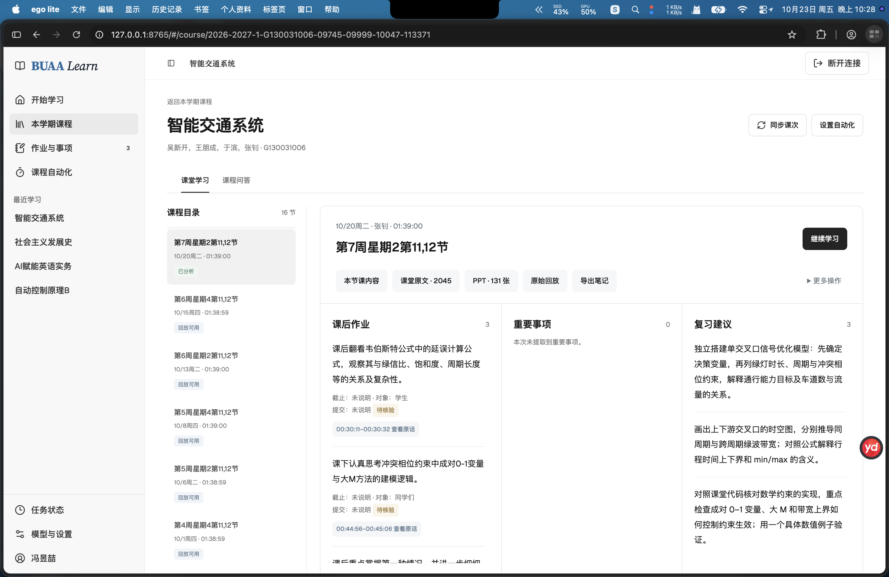
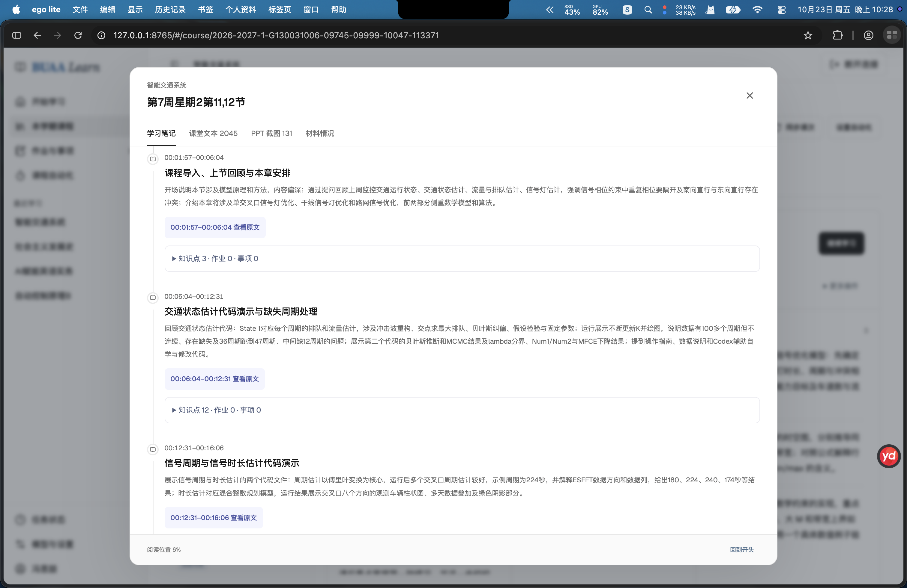
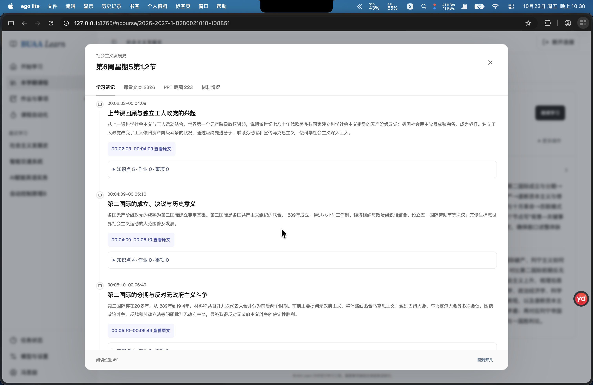

# BUAA Learn

**缺过的课，方便补；上过的课，方便复习。**

面向北航学生的本地课程学习助手。通过学校 SSO 同步本学期课程和课表，把录播平台提供的课堂识别文本与 PPT 截图，整理成带来源的学习笔记、课后作业和重要事项。

独立运行，不需要 Ego、Codex 或浏览器插件。非北航官方应用。

## 能做什么

- **课堂笔记与时间轴**：按讲授主题整理内容、知识点和例子，点击时间范围查看对应课堂原文。
- **作业与重要事项**：提取明确布置的任务，以及老师明确提及的考试提示、考核要求、点名签到、课堂小测和关键安排，保留原文依据。
- **整课复习重点**：归纳最多 3 条复习建议，帮助回顾本节课的核心难点。
- **课堂问答**：围绕已获取的课堂文本提问，回答附材料来源。
- **去重课件 PDF**：按截图画面内容保守去重，保留首次出现顺序，一键导出方便阅读与批注的图片型 PDF。
- **课程自动化**：批量选择课程，上课次日起每 2 小时检查新回放，可选择仅获取材料或同时生成笔记。
- **阅读位置记忆**：按账号和课次记住阅读标签、搜索词和滚动位置，下次打开继续阅读。

作业和重要事项由 AI 从识别文本中整理，可能错漏；“未提取到”不代表老师没有布置。考试提示只整理课堂中明确提及的内容，不保证覆盖所有考点。

## 真实使用截图

以下为作者提供的真实使用截图。截图中的录播平台、浏览器和系统界面仅用于展示使用场景，运行本项目不依赖截图中的浏览器。

**课堂概览：作业、重要事项和复习建议**



**按主题整理的课堂时间轴，可回到对应原文**



**不同课程的课堂内容整理**



## 桌面版

macOS 和 Windows 用户可从 [GitHub Releases](https://github.com/fyzzzz05/BUAA-Learn/releases) 下载桌面安装包：Apple Silicon / Intel Mac 使用对应架构的 `.dmg`，Windows x64 使用 `.exe`。安装包内置 Python 服务和登录浏览器，无需安装开发环境。

**0.2.0 桌面测试版下载：** [Apple Silicon Mac](https://github.com/fyzzzz05/BUAA-Learn/releases/download/desktop-v0.2.0/BUAA-Learn-0.2.0-mac-arm64.dmg) · [Intel Mac](https://github.com/fyzzzz05/BUAA-Learn/releases/download/desktop-v0.2.0/BUAA-Learn-0.2.0-mac-x64.dmg) · [Windows x64](https://github.com/fyzzzz05/BUAA-Learn/releases/download/desktop-v0.2.0/BUAA-Learn-0.2.0-win-x64.exe)

首次打开后点击 **SSO 登录**；模型可在 **模型与设置** 配置，或通过菜单 **文件 → 打开配置目录** 编辑 `.env.local` 后重启。配置、课程和笔记保存在本机，安装包不包含作者的 API 密钥或课堂数据。

当前为未签名测试版，尚未配置 Apple 公证或 Windows 代码签名。构建、配置、数据迁移与测试方式见 [桌面版说明](docs/desktop.md)。

## 从源码运行

需要 **Python 3.11+** 和 **Google Chrome**。macOS 已完成真实课程使用；Windows 桌面版通过构建、窗口启动、内置浏览器和 PDF 导出自动测试，学校登录仍需在实际校网环境验证。Linux 尚未实测。前端构建产物已包含在仓库中，普通使用无需安装 Node.js。

```sh
git clone https://github.com/fyzzzz05/BUAA-Learn.git
cd BUAA-Learn
python3 -m venv .venv
source .venv/bin/activate
python -m pip install -e .
cp .env.example .env.local
```

在 `.env.local` 中填写模型服务地址、模型名称和 API Key，再启动：

```sh
buaa-agent
```

打开 <http://127.0.0.1:8765>。macOS / Linux 也可以运行 `./start.sh`，脚本会准备环境并启动服务。Windows PowerShell 使用 `.\.venv\Scripts\Activate.ps1` 激活环境，使用 `Copy-Item .env.example .env.local` 复制配置文件。

如果没有 Chrome，可运行 `python -m playwright install chromium`，在 `.env.local` 中设置 `BUAA_BROWSER_CHANNEL=chromium`；已安装 Edge 的用户可设置为 `msedge`。

未配置模型时仍可登录、同步课程、阅读原文与截图、导出去重 PDF；生成笔记和课堂问答需要模型服务。

## 使用流程

1. 点击 **SSO 登录**，在新开的普通浏览器窗口完成学校统一身份认证。学校密码只输入学校页面。
2. 同步本学期课程和课表，课程按回放数量排序；课表中的课程也可直接点击进入。
3. 进入课程后同步课次，选择一节有回放的课并获取课堂材料。
4. 点击 **分析这节课** 生成笔记。顶部和阅读弹窗显示任务进度；分析完成后查看课堂时间轴、作业和重要事项。
5. 在 **课程问答** 中提问；在 **PPT 截图** 中点击 **导出去重 PDF**，完成后下载；也可以导出包含原文的 Markdown 笔记。

### 自动整理课程

在 **课程自动化** 中勾选“自动获取”，按需打开“自动生成笔记”，最后点击 **保存更改**。

- 支持课程搜索、全选／全不选和只看已开启；筛选时批量操作只影响当前列表。
- 修改先形成草稿，保存后生效；保存失败时保留未保存的更改，支持重试。
- 未开启自动获取时，笔记开关禁用；关闭自动获取会同步关闭自动笔记。
- 依据真实课表，上课次日 00:00（北京时间）起每 2 小时检查。首次开启从昨天的课次开始，历史课次可手动分析。
- 未出回放、材料未就绪或处理失败时保留待检查课次；处理成功后停止追踪，避免重复调用模型。
- 每日更新过去 7 天至未来 21 天的课表；课表缺失时等待同步，不猜测每周重复安排。
- **需要本地服务持续运行、学校登录有效**。关闭服务后不执行，也没有系统级后台守护或消息推送。

自动生成笔记会将课堂文本发送至你配置的模型服务，并可能产生调用费用。仅获取材料和导出 PDF 不调用模型。

## 模型与环境变量

启动命令自动读取启动目录的 `.env.local`；若不存在，则读取源码项目目录中的同名文件。已设置的系统环境变量优先。

| 变量 | 用途 |
| --- | --- |
| `BUAA_DATA_DIR` | 本地数据目录，默认 `./data` |
| `BUAA_LLM_BASE_URL` | 模型服务根地址或兼容接口地址 |
| `BUAA_LLM_MODEL` | 模型 ID |
| `BUAA_LLM_API_KEY` | 模型密钥，本地无鉴权服务可留空 |
| `BUAA_BROWSER_CHANNEL` | `chrome`、`msedge` 或 `chromium` |

也可在 **模型与设置** 中配置服务。界面填写的 API Key 仅在当前进程中保留；通过 `.env.local` 配置的密钥会在每次启动时重新加载，文件不会提交到 Git。

DeepSeek 官方地址 `https://api.deepseek.com`（也支持 `/v1` 后缀）使用 Responses API 和 `json_schema`；其他服务使用兼容 Chat Completions 的 JSON 输出接口。本地模型支持 `http://localhost:端口/v1`。模型是否支持相应接口和结构化输出，请以服务商配置为准。

## 分析与导出边界

- 分段遍历全部已获取的识别文本，保留知识点、作业与重要事项的来源编号。引用有效不代表内容一定正确，重要要求请核对原话。
- 截止时间需要明确的原文证据，不自行推算。作业默认标为“待核验”；点名考勤与课堂提问、课堂小测与普通例题分别处理。
- 时间轴按主题展示；超过 45 秒的文本空白，以及尚未归类的文本分别标记。主题整理失败时保留已通过校验的内容并显示部分待整理状态。
- 无效 JSON、格式或引用校验失败时会有限重试；鉴权、网络和限额错误明确报错，不覆盖已有有效结果。
- **目前分析基于识别文本，尚未实现 PPT OCR、视觉理解、缺失音频补转写或原声核验。** 文本时间覆盖率不等于识别准确率。
- 问答使用中英文关键词检索，并非向量或知识图谱检索，可能遗漏相关片段。
- PDF 保留截图原始分辨率，无损嵌入，不裁切画面；它是截图合集，不是可编辑 PPT，也不包含可搜索文字层。
- 截图按画面内容保守去重，可合并非相邻重复页，尽量保留局部文字、批注与颜色变化；近似画面仍可能保留，也可能包含桌面或课堂演示。
- 导出最多并行下载 4 张图，单次最多 1000 张；单图及总量有上限。读取失败会报错，旧的完整导出保留。

## 数据与登录

课程、课表、识别文本、截图索引、笔记、问答、作业及自动化规则保存在本地 SQLite；导出的 PDF 保存在 `data/exports/`。学校 token、Cookie 和模型密钥不写入数据库。

浏览器使用独立临时资料目录完成 SSO 和录播登录握手，随后通过 HTTP 获取课程材料；不会读取你已有的浏览器资料或自动提交学校作业。学校凭据保留在内存，服务重启后需要重新登录。

服务只绑定 `127.0.0.1`，限制 Host 和跨站写请求；这是个人电脑上的单用户应用，不能直接当作公网多用户服务部署。

**请勿提交 `.env.local`、`data/`、数据库、登录资料或批量下载的课堂材料。** 仓库仅提供程序和作者选定的展示截图，测试使用合成数据。

## 开发

后端使用 Python / FastAPI / SQLite，前端以 JavaScript 页面配合 React / TypeScript 组件运行，使用 shadcn Base UI 的 Sidebar、Combobox、Progress、Checkbox 和 Switch。

```sh
python -m pip install -e '.[dev]'
python -m pytest -q
ruff check buaa_agent tests

cd frontend
npm ci
npm run typecheck
npm run build
```

构建后的 JavaScript 和 CSS 输出到 `buaa_agent/static/`，由本地服务提供。前端组件来源与校验记录见 `frontend/*-sources.json`；主要结构和接口见 [docs/architecture.md](docs/architecture.md)。

学校接口使用内部协议，可能随平台更新变化。遇到登录、课程映射或材料接口问题，欢迎提交不含账号、密钥和课堂原文的复现信息。

## 开源与致谢

项目采用 [MIT License](LICENSE)，第三方组件、字体与图标保留各自许可证，见 [THIRD_PARTY_NOTICES.md](THIRD_PARTY_NOTICES.md)。

学习工作台的组织与视觉布局受到 [HKUDS/DeepTutor](https://github.com/HKUDS/DeepTutor) 启发。本项目独立实现，尚未接入 DeepTutor，不与北航或录播平台存在官方合作关系。
